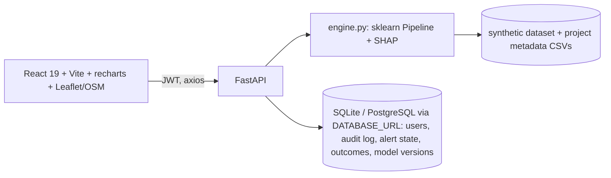

# TerraFore — Land Acquisition Delay-Risk Prototype (SIH Round 2)

> Current systems tell officials what has already happened. TerraFore predicts what could go wrong before it becomes a critical delay: Predict → Explain → Recommend → Monitor. It doesn't just identify risk; it helps officials understand it and simulate what could happen if a bottleneck is addressed.

**Honesty notes.** All data is **synthetic** (not real or government data). Simulations are *scenario estimates, not a guarantee*. TerraFore does not decide whether forest land may be acquired and never recommends bypassing statutory forest/environmental clearance. The forest flag is rule-based and is not a model feature. No SSO or government-system integration is built.

## Architecture


## Quick start
Requires Python 3.12/3.13 and Node LTS. From the repo root:
```bash
python -m pip install -r requirements.txt
python -m uvicorn api:app --host 127.0.0.1 --port 8000     # or run_backend.sh / run_backend.bat
cd interface && npm install && npm run dev                  # or run_frontend.sh / run_frontend.bat
```
Open http://localhost:5173. API docs: http://127.0.0.1:8000/docs. Tests: `python -m pytest tests -q`, `cd interface && npm run build && npm run lint`.
Environment: `DATABASE_URL` (default SQLite file `terrafore.db`), `JWT_SECRET` (a clearly marked **dev default** is used if unset; set it for anything beyond a local demo).
`requirements.txt` pins scikit-learn 1.9.1 because the pickled model depends on it. Do not change it.

## Demo accounts (prototype) — password `Demo@1234`
| Account | Role |
|---|---|
| officer@terrafore.demo | Land Acquisition Officer |
| authority@terrafore.demo | Project Authority |
| admin@terrafore.demo | Administrator (seeded only; cannot be created via signup) |

| Capability | Officer | Authority | Admin |
|---|---|---|---|
| Dashboard, Projects, Predict, Simulator, GIS, Analytics, Alerts | yes | yes | yes |
| Acknowledge alerts, export projects CSV, record outcomes | no | yes | yes |
| Audit log, users, retrain model | no | no | yes |

A user with `state_jurisdiction` only sees that state's projects.

## SIH requirement → where demonstrated
| SIH requirement | Implementation | Where |
|---|---|---|
| ML-based delay prediction | Logistic Regression pipeline | `/predict`, `/predict/batch` |
| Auto-identify high-risk projects | All 5,000 projects scored at startup | Dashboard, Projects |
| Project-wise risk scoring | `risk_score` 0–100 + level | every project |
| Key delay drivers / Explainable AI | SHAP `LinearExplainer`, plain-language drivers | Predict, Project Detail |
| Stage-wise risk across lifecycle | Derived 5-stage timeline (see caveat) | Predict, Project Detail |
| Dashboards & comparative analytics | recharts + KPIs | Dashboard, Analytics |
| GIS visualisation | Leaflet + OpenStreetMap, synthetic coordinates | GIS |
| Alerts | Rules on real scores, deadlines, clearance status; acknowledge | Alerts |
| Predictive recommendations | Priority actions + model-ranked highest-impact fix + what-if simulator | Predict |
| Continuous learning | Outcome recording + admin retrain with AUC-guarded hot-swap (demo) | Profile → Administration → Models |
| APIs for integration | OpenAPI `/docs`, `/api/v1/*`, `/predict/batch` | backend |
| Secure role-based access + audit trail | JWT, 3 roles, audit log | backend, Profile |

| Parameter (SIH text) | Source in prototype |
|---|---|
| Project type, land area, affected families, compensation, legal disputes, possession, rehabilitation, stakeholder responsiveness | model inputs |
| Approval timelines | `approval_completion_pct` (model input) + `planned_completion_date` (metadata; display and alerts) |
| Historical performance | display-only: delay rate of same state / project type in the dataset; not a model feature |
| Environmental/forest clearance | rule-based compliance flag from metadata; **not a model feature** |

| Component | Technology |
|---|---|
| Frontend | React 19, Vite, react-router, axios, recharts |
| GIS | Leaflet, react-leaflet, OpenStreetMap tiles |
| Backend | FastAPI, Pydantic, Uvicorn |
| ML / Explainability | scikit-learn Pipeline, pandas, joblib, SHAP |
| Database | SQLAlchemy — SQLite default, PostgreSQL via `DATABASE_URL` |
| Auth | PyJWT, PBKDF2 (stdlib `hashlib`), roles, audit log |
| Testing | pytest, `npm run build`, `npm run lint` |

## API (all `/api/v1/*` and `/predict*` need a Bearer token)
`GET /`, `GET /health` (public) · `POST /predict` (+`?project_id=`) · `POST /predict/batch` (≤500) · `POST /api/v1/auth/{signup,login,logout}`, `GET /api/v1/auth/me` · `GET /api/v1/stats` · `GET /api/v1/projects` (filters, paging) · `GET /api/v1/projects/{id}` · `GET /api/v1/projects/export` (Authority/Admin) · `GET /api/v1/gis/projects` · `GET /api/v1/demo-projects` · `GET /api/v1/model/info` · `POST /api/v1/simulate` · `GET /api/v1/alerts`, `POST /api/v1/alerts/{id}/acknowledge` · `POST /api/v1/outcomes` · `GET /api/v1/admin/{audit,users,models}`, `POST /api/v1/admin/retrain`.
`POST /predict` keeps its original fields (`prediction`, `delay_probability`, `risk_level`, `key_factors`, `priority_actions`) and adds `risk_score`, `lifecycle_stages`, `compliance`, `action_impact`, `historical_context`, `disclaimer`.

## Model card & limitations
Scikit-learn Pipeline (preprocessing + Logistic Regression) trained on 4,000 of 5,000 synthetic rows. Held-out 1,000 rows (`random_state=42`, stratified): ROC-AUC 0.9399, accuracy 0.865, delayed-class precision 0.889, recall 0.865, F1 0.877 (served live at `/api/v1/model/info`). 5-fold CV ROC-AUC ≈ 0.942.
- Metrics demonstrate technical feasibility only; real deployment needs retraining and validation on authorised historical data.
- The synthetic dataset scores ~51% HIGH / 12% MEDIUM / 36% LOW (avg delay probability ~55%). The dashboard reflects this; nothing is faked.
- Lifecycle stage colours are derived from completion levels and SHAP; they are not separately trained stage models.
- Alerts are rule-based and numerous on this dataset (thousands), because the synthetic portfolio is high-risk-heavy.
- Simulation and "highest-impact fix" are model-based scenario estimates, not causal guarantees.
- Project names, districts, coordinates, dates and forest flags come from `scripts/generate_project_meta.py` (seeded, fictional).

## Folder map
`api.py` FastAPI app · `engine.py` scoring/SHAP/simulation · `auth_db.py` DB, auth, audit · `terrafore_model.pkl` · `terrafore_synthetic_dataset.csv` · `terrafore_project_meta.csv` · `scripts/generate_project_meta.py` · `tests/` · `interface/` React app · original scripts (`data.py`, `predict.py`, `validate_model.py`, `explain.py`, …) unchanged · `DEMO_SCRIPT.md` · `JURY_QA.md`.

## Future scope
Real historical data and validation, district-level ground truth, non-linear models with calibration, PostgreSQL deployment, proper secrets management, state-aggregate GIS layer, scheduled outcome ingestion. Python 3.13 was not available in the build environment; it is expected to work with the pinned versions but was tested on 3.12 only.
